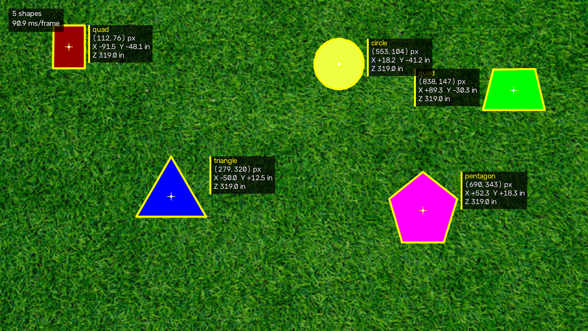
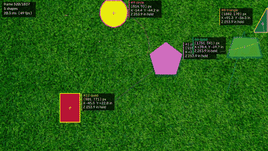
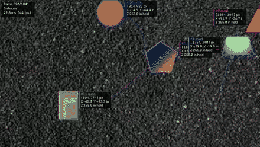
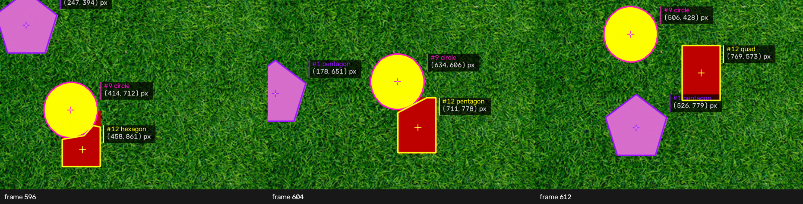
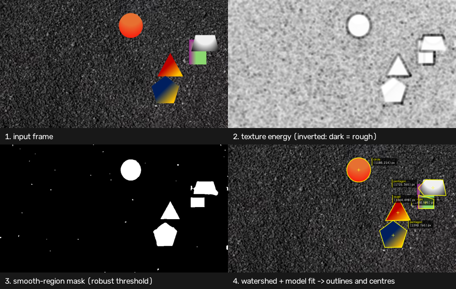

# PennAiR 2026 Software Challenge — Shape Detection

Find solid shapes on any textured background, trace their outlines, mark their
centres, and put them in metric 3D — on a static image, on video streamed frame
by frame, and on a background the algorithm has never seen.

No pretrained models, no end-to-end solvers: classical CV, one idea, four
supporting stages.

| Part | Status | Where |
| --- | --- | --- |
| 1 — static image | ✅ | [`outputs/static_annotated.png`](outputs/static_annotated.png) |
| 2 — video, streamed frame by frame | ✅ | [`outputs/dynamic_annotated.mp4`](outputs/dynamic_annotated.mp4) |
| 3 — background agnostic (+ colour gradients) | ✅ | [`outputs/hard_annotated.mp4`](outputs/hard_annotated.mp4) |
| 4 — depth + X/Y in inches | ✅ | `--3d` flag, [`pennair/depth.py`](pennair/depth.py) |
| 5 — ROS 2 nodes + launch file | ✅ | [`ros2_ws/src/`](ros2_ws/src) |
| 6 — extras: tracking through overlap, model fitting, tests, metrics | ✅ | below |

**The same detector, with the same parameters, runs all of it.** Nothing is
tuned per video.

---

## Results

### Part 1 — static image



All five shapes, mean **IoU 0.988** against an independent colour-based ground
truth, mean centre error **0.36 px**.

### Parts 2 & 3 — video

Grass (Part 2) and the hard background with gradient fills (Part 3). Previews
are downsampled GIFs; the full-resolution results are the MP4s linked above.

| Part 2 — `dynamic.mp4` | Part 3 — `dynamic_hard.mp4` |
| --- | --- |
|  |  |

Over both full videos (3 678 frames, streamed one frame at a time):

* **0 frames with zero detections**, ~50 fps on one CPU core at 1080p
* recovered depth **254.0 ± 0.32 in** (grass) and **254.8 ± 0.35 in** (hard) —
  the same physical scene measured two ways, agreeing to 0.3%
* no parameter changed between the two runs

### Part 6 — tracking through overlap

IDs survive shapes passing over each other; an occluded shape keeps its identity
and its outline follows the part that is still visible.



---

## Quick start

```bash
git clone <this repo> && cd penn-air-sw-challenge
python3 -m venv .venv && source .venv/bin/activate
pip install -r requirements.txt
```

Put the three challenge files in `data/` as `static.png`, `dynamic.mp4` and
`dynamic_hard.mp4` (see [`data/README.md`](data/README.md)), then:

```bash
python main.py image data/static.png -o outputs/static_annotated.png --3d
```

```bash
python main.py video data/dynamic.mp4 -o outputs/dynamic_annotated.mp4 --3d
```

```bash
python main.py video data/dynamic_hard.mp4 -o outputs/hard_annotated.mp4 --3d
```

Live from a webcam, no files involved:

```bash
python main.py video 0 --show --3d
```

Useful flags: `--show` (window), `--json out.json` (machine-readable
detections), `--debug` (dump every pipeline stage as an image), `--no-track`
(per-frame detections only), `--work-width` (speed/accuracy trade-off),
`--max-frames N`.

---

## How it works

### The idea

Colour is the obvious cue and it is a trap. "Not green" finds the shapes on
grass and nothing at all on gravel; the hard video then adds gradient fills, so
even the shapes have no single colour. Anything keyed to specific colours needs
re-tuning per background, which is exactly what Part 3 forbids.

What actually separates foreground from background here has nothing to do with
colour:

> **Backgrounds are textured. Shapes are smooth.**

Grass and gravel churn from pixel to pixel. A solid shape — flat fill or smooth
gradient — does not. That test is colour-blind, so it transfers to a background
the code has never seen.

### Pipeline



1. **Texture energy.** Convert to CIE-Lab, subtract the local mean, take the
   local RMS of what is left. Two box filters, O(1) per pixel.
2. **Robust threshold.** Shapes are low-side outliers of that map: the cut is
   `median − k·MAD` in log space, computed per frame.
3. **Clean up.** Small opening, closing, hole fill.
4. **Watershed.** Seed from each blob's eroded core and flood out to the true
   edge — the texture test necessarily loses about half a window's width at
   every boundary.
5. **Model fit.** Fit every n-gon (3–8) and an ellipse; keep whichever explains
   the outline best. Corners come from intersecting least-squares edge lines, so
   they land where the geometry says, not where morphology rounded them off.

Then centres from image moments, a greedy tracker for IDs, and the pinhole
model for 3D.

### Three decisions that mattered

Each of these started as the textbook choice and had to be replaced. The full
story, with the measurements, is in [`docs/report.md`](docs/report.md).

**Local variance → local variance *after removing the local mean*.** A standard
deviation over a window is the natural smoothness measure, but a gradient fill
has plenty of variance inside any window, so the red-to-yellow triangle scored
like grass and was discarded. A box filter reproduces a linear ramp exactly, so
subtracting the local mean first leaves a residual that is *zero* across a
gradient and large on texture. On the hard video that moved a gradient region
from 8.1 to 0.8 against a background of ~15: 20× separation instead of 2×.

**Otsu → robust outlier statistics.** Otsu assumes two comparable classes. The
background is 97% of the pixels, so its two classes came out as "darker grass"
and "brighter grass", with the threshold at 4.9 while the shapes sat at 8.1.
Because the background dominates, the frame's median and MAD *are* the
background's statistics — so the shapes can be picked out as outliers instead.

**Explicit overlap splitting → nothing.** Touching shapes were being cut apart
along Laplacian seams. Once the texture cue was right, that code was deleted
outright: the seam between two shapes *is* a step edge, so it fails the
smoothness test and the mask arrives with a hairline gap already in it. Every
frame where shapes overlap still yields one connected component per shape. The
only thing the splitter reliably split was gradient fills.

---

## Part 4 — 3D

A pinhole camera discards scale, so one known length has to come back in. The
brief gives it: the circle is 10 in in radius.

```
Z = f · R / r_px                       depth of the plane
X = (u − cx) · Z / fx,  Y = (v − cy) · Z / fy
```

"Assume a flat surface" is what makes one measurement enough for every shape:
they share the circle's plane, so they share its depth, and the same scale
converts each shape's size to inches.

The circle is only trusted as the ruler when it is fully visible, genuinely
round, and ellipse-fitted; otherwise the last good scale is held and the output
is flagged (`held` in the overlay). Recovered radius is stable to **±0.13 px**
over 1 200 frames, giving **254.0 ± 0.32 in** ≈ 21.2 ft.

**One note on the given `K`:** it has `cx = cy = 0`, which places the principal
point at the top-left corner. Taken literally, every X/Y is biased by half the
sensor. The default is therefore the image centre — the physically sensible
reading of a simplified brief — and `--literal-principal-point` uses the matrix
exactly as written. Depth `Z` is unaffected either way.

---

## Part 5 — ROS 2

Two packages in [`ros2_ws/src/`](ros2_ws/src):

* **`pennair_msgs`** — `Shape.msg` / `ShapeArray.msg`: ID, label, occlusion
  flag, centre, full outline polygon, and the 3D position in inches.
* **`pennair_vision`** — `video_publisher` (a video file as
  `sensor_msgs/Image`, standing in for the camera driver) and `detector_node`
  (a thin wrapper around this same `pennair` package — no duplicated algorithm).

```bash
# Ubuntu 24.04 / ROS 2 Jazzy
cd ~/penn-air-sw-challenge && pip install -e .     # makes `pennair` importable
cd ros2_ws && colcon build && source install/setup.bash

ros2 launch pennair_vision detection.launch.py \
    video_path:=$HOME/penn-air-sw-challenge/data/dynamic_hard.mp4
```

| Topic | Type | Contents |
| --- | --- | --- |
| `/camera/image_raw` | `sensor_msgs/Image` | the streamed video |
| `/pennair/shapes` | `pennair_msgs/ShapeArray` | centres, outlines, 3D positions |
| `/pennair/image_annotated` | `sensor_msgs/Image` | the overlay, for `rqt_image_view` |
| `/pennair/markers` | `visualization_msgs/MarkerArray` | outlines for RViz |

```bash
ros2 topic echo /pennair/shapes
ros2 run rqt_image_view rqt_image_view /pennair/image_annotated
```

Launch arguments: `loop`, `track`, `estimate_3d`, `work_width`, `rviz`.

> Developed and measured on macOS; the ROS 2 packages follow the standard
> `ament_cmake` (messages) + `ament_python` (nodes) layout for Jazzy.

---

## Part 6 — extras

* **Tracking through occlusion** — constant-velocity prediction, gated greedy
  matching with colour and area as tie-breakers (position alone swaps IDs when
  two shapes overlap), and coasting for up to 15 frames while a shape is hidden.
  Tracks that stop being seen *at the frame edge* are dropped rather than
  coasted: that shape left the field of view, it is not occluded.
* **Geometric model fitting** — sub-pixel outlines and a far steadier circle
  radius, which is what makes the depth estimate stable.
* **Shape classification** — falls out of the model fit for free.
* **Test suite** — `pytest -q`, 17 tests on synthetic scenes, so it runs on a
  fresh clone with no media. Covers four unrelated backgrounds, gradient fills,
  overlap, tracking, occlusion coasting and the 3D maths.
* **Reproducible metrics** — `python tools/evaluate.py` regenerates every number
  quoted here into [`docs/metrics.md`](docs/metrics.md).

---

## Limitations

Honest list of what this does not do:

* **Two overlapping shapes of the same colour** merge into one blob. Nothing
  photometric can separate them; it would need shape priors.
* **A shape occluded into two disconnected pieces** is reported as two shapes
  (4 frames out of 1 841). Amodal completion would fix it.
* **A perfectly smooth background** (studio backdrop, calm water) breaks the
  core assumption. The code detects the degenerate case and falls back to Otsu,
  but the honest answer is that a different cue is needed there.
* **Depth assumes one plane** viewed head-on, as the brief specifies. Shapes at
  different heights would need per-shape scale.
* **Motion blur** at higher speeds would blur the texture too and shrink the
  separation; the texture window would have to grow to compensate.

---

## Repository layout

```
pennair/            the algorithm
  detector.py       texture cue, thresholding, watershed, model fitting
  tracker.py        IDs, motion model, occlusion handling
  depth.py          pinhole model, scale from the reference circle
  overlay.py        outlines, centres, labels, HUD
  io_utils.py       frame-at-a-time video streaming
main.py             CLI for every part
tests/              synthetic-scene test suite (no media needed)
tools/evaluate.py   regenerates docs/metrics.md
tools/make_assets.py regenerates the figures in this README
ros2_ws/src/        Part 5: pennair_msgs + pennair_vision
docs/report.md      the write-up: approach, what failed, what changed
outputs/            processed image and videos
```

```bash
pytest -q                    # tests
python tools/evaluate.py     # metrics
```

---

Abel Mesfin Teka · tekaam@sas.upenn.edu
